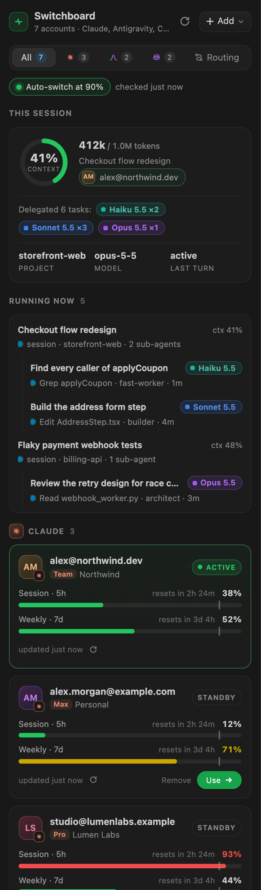
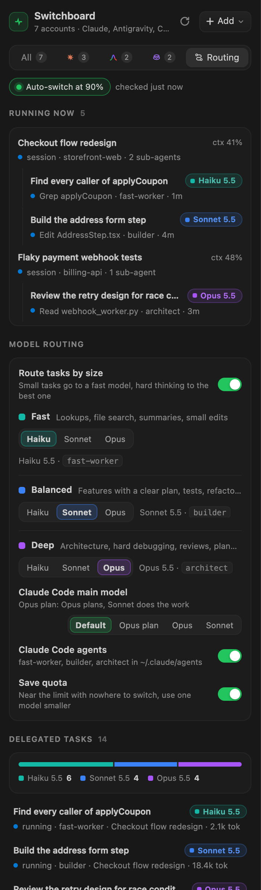
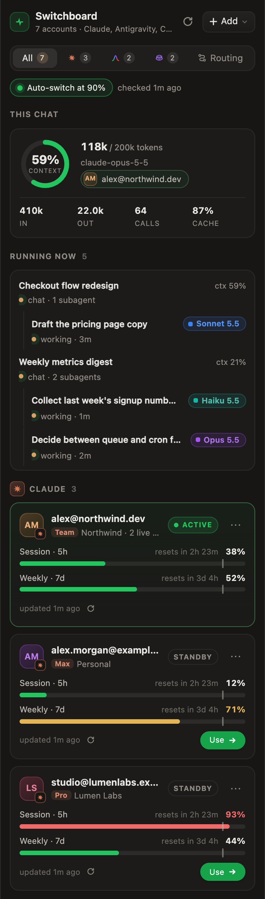
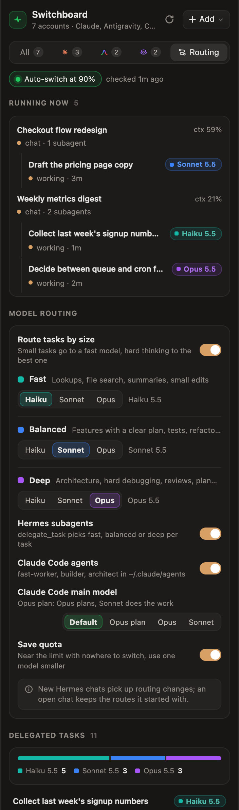

# Switchboard

**One panel for all your AI coding accounts.** Switchboard keeps several Claude, Antigravity and GitHub Copilot logins side by side, shows how much of each one is used, switches to another account before one runs out, and sends each task to a model that fits its size.

It runs in three places and looks the same in each: **VS Code**, the **Hermes** desktop app, and **Claude Code** in the terminal.

<p>
  
  &nbsp;&nbsp;
  
</p>

*Screenshots use made-up accounts and projects.*

## What it does

| | |
|---|---|
| **Live usage per account** | Claude's 5-hour and weekly limits, Antigravity's quota per model group, and Copilot's premium requests. Each bar shows when it resets and where the switch threshold sits. Every card has its own refresh button. |
| **Automatic switching** | When the account in use reaches the threshold (90% by default), Switchboard moves to the least-used account that still has room. |
| **Context per session** | A ring shows how full the current session's context window is, with a list of your other recent sessions. |
| **Model routing** | Small tasks go to a fast model, standard work to a balanced one, and hard thinking to the best one. You pick the model for each tier. |
| **Running now** | Every session that is working and every sub-agent it started, with the model each one runs on and what it is doing. |
| **Delegated tasks** | A history of every task that was handed off: the model it ran on, how it ended and how many tokens it used. |
| **Several accounts per provider** | One **Add** button connects Claude, Antigravity or GitHub Copilot. Providers you have no account for stay hidden. |

## Install

```bash
bash install.sh                 # everything it can find: Claude Code, VS Code, Hermes
bash install.sh --vscode        # or one at a time: --claude-code / --vscode / --hermes
bash install.sh --watch         # also check and switch in the background (launchd, every 3 min)
```

Requirements: Python 3.9 or newer (standard library only) and macOS for Keychain-based switching. The VS Code extension has no build step and no dependencies.

Then connect your other accounts with **Add** in the panel, or from the terminal:

```bash
python3 ~/.claude-accounts/bin/claude_accounts.py add
```

After installing, reload the VS Code window and start new Claude Code sessions so they pick up the changes.

## Where it runs

| Surface | What you get |
|---|---|
| **VS Code** | A Switchboard panel in the activity bar and a status-bar item that shows usage. Click the status-bar item to switch accounts. |
| **Hermes desktop** | A right-sidebar pane with the same design. It switches the Hermes credential pool and moves idle chats to the new account. |
| **Claude Code** | A status line (`◆ Alex Team 5h 21% wk 10% │ ctx 37% 368k/1000k`), the `/accounts` and `/switch-account <email>` commands, and MCP tools (`claude_accounts_status`, `_switch`, `_settings`). |

<p>
  
  &nbsp;&nbsp;
  
</p>

## Accounts

Click **Add** at the top of the panel and pick a provider. You can add several accounts for each one.

| Provider | Sign-in | Usage shown | What **Use** and auto-switch change |
|---|---|---|---|
| Claude | claude.ai, then paste the code | 5-hour and weekly limits | Claude Code's login (Keychain) in the terminal and VS Code, and the Hermes credential pool |
| Antigravity | Google sign-in in your browser | Quota per model group: Claude · GPT, Gemini Pro, Gemini Flash | Antigravity's own login, used by the app, the `agy` CLI and its VS Code extension. Restart Antigravity or reload VS Code to apply. |
| GitHub Copilot | GitHub device code | Premium requests, or chat and completions on the free plan | In VS Code it opens VS Code's own Copilot account picker, because VS Code has no way to switch it silently. For Neovim, JetBrains, Xcode and Zed it rewrites `~/.config/github-copilot/apps.json`. |

- The active account always sits at the top of its list. **Use** is the green button on every other card.
- The small refresh icon next to "updated …" on a card re-reads that one account. The refresh button in the header re-reads all of them.
- One threshold applies to every provider. You can turn auto-switch off per provider with the **auto** pill on its section.
- If you switch by hand to an account that is already over the threshold, it is pinned: auto-switch leaves it alone until that limit resets.
- If every account is over the threshold, nothing changes and the activity log says so.

### How switching works in Claude Code and VS Code

- Claude Code holds one login: the macOS Keychain item `Claude Code-credentials`, or `~/.claude/.credentials.json` on other systems.
- Saved accounts live in `~/.claude-accounts/accounts.json` (mode 0600).
- On a switch, Switchboard first saves the current login back into its store, backs it up (`~/.claude-accounts/backups/`, last 20 kept), and then writes the chosen account into Claude Code's slot.
- New Claude Code sessions start on the new account. A session that is already open keeps its login until you restart it.

### One thing to know about Hermes

Hermes can hold a login called `claude_code`, which follows whichever account Claude Code is signed into. When you switch accounts in Claude Code or VS Code, that Hermes login becomes the new account too. If it ends up being the same account as another Hermes login, the pane says so on the card, because the two share one limit. To keep an account in Hermes no matter what Claude Code does, add it in the Hermes pane with **Add**.

## Model routing

The **Routing** tab has three tiers. Pick Haiku, Sonnet or Opus for each.

| Tier | Default | Used for | Claude Code agent | Hermes route |
|---|---|---|---|---|
| Fast | Haiku | lookups, file search, summaries, small edits | `fast-worker` | `fast` |
| Balanced | Sonnet | features with a plan, tests, refactors | `builder` | `balanced` (used when a task picks none) |
| Deep | Opus | architecture, hard debugging, reviews, plans | `architect` | `deep` (high reasoning) |

- **Claude Code** gets three sub-agents in `~/.claude/agents/`, each with its own `model:`. Claude Code picks one from its description, so routing is good but not perfect. Only files marked `managed-by: ai-accounts` are ever rewritten; a sub-agent of your own with the same name is left alone.
- **Claude Code main model** is optional. *Opus plan* means Opus plans and Sonnet does the work.
- **Hermes** uses its official `advanced-delegation` plugin (`delegation.backend: model_map`). Routes you wrote yourself are never overwritten, and turning routing off restores the default. New chats pick up changes; a chat that is already open keeps the routes it started with.
- **Save quota**: when the active Claude account is over the threshold and there is no account to switch to, every tier drops one model (Opus to Sonnet, Sonnet to Haiku) until usage recovers.

## Running now and delegated tasks

**Running now** sits near the top of the panel whenever something is working. It lists each active session with its context use, and under it the sub-agents that session started: the task, the model, and the last thing the sub-agent did (for example `Edit AddressStep.tsx`). It disappears when nothing is running; on the Routing tab it stays visible and says so.

**Delegated tasks** on the Routing tab is the history. A bar shows the split between models, and each row shows the task, the model it actually ran on, how it ended, and its output tokens.

VS Code shows Claude Code's sessions and sub-agents. The Hermes pane shows Hermes chats and subagents.

**Activity** at the bottom logs switches, new accounts and routing changes. Click its heading to collapse it; the panel remembers your choice.

## Command line

```
claude_accounts.py status [--json] [--refresh] [--refresh-account <id> --provider <name>]
claude_accounts.py add | import | use <email|label|id> | remove <account>     (--provider antigravity|copilot)
claude_accounts.py config threshold=90 auto_switch=on poll_seconds=180 windows=five_hour,seven_day
claude_accounts.py routing [tiers.fast=haiku] [claude_code_main=opusplan] [enabled=off]
claude_accounts.py delegations
claude_accounts.py check | watch | statusline | mcp
```

## Privacy

- Logins stay on your machine: in the macOS Keychain and in `~/.claude-accounts/` (files are mode 0600).
- Switchboard talks only to each provider's own servers: Anthropic, Google and GitHub.
- Antigravity's sign-in details are read from the Antigravity app installed on your Mac. They are not shipped with this project.
- Logins that only Hermes holds are never copied out of Hermes. Sharing one would sign one side out.

## Project layout

The product is called Switchboard. Folders, commands and settings keep the original `claude-accounts` id so existing installs keep working.

```
core/claude_accounts.py        the engine: CLI, MCP server and status line
core/providers.py              Antigravity and GitHub Copilot accounts
core/routing.py                model routing, running tasks and the delegation history
ui/                            shared design for both panels
tools/build.py                 builds both panels from ui/ and copies the engine into each
claude-code/                   installer and the /accounts and /switch-account commands
vscode-extension/              extension source and claude-accounts-1.3.0.vsix
hermes/plugins/claude-accounts Hermes backend
hermes/desktop-plugins/…       Hermes right-sidebar pane
docs/images/                   README screenshots
```

To change the UI, edit `ui/` and run `python3 tools/build.py --install`. Don't edit `vscode-extension/media/panel.js` or `panel.css` by hand; they are generated.

## Uninstall

```bash
bash claude-code/install.sh --uninstall
hermes plugins disable claude-accounts
```

Then remove the extension in VS Code.
